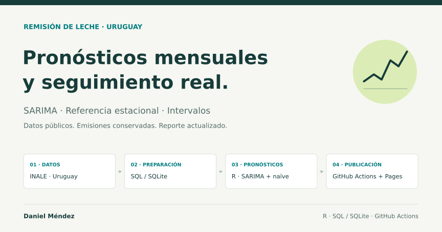

::: {.hero-banner .hero-banner--applied-projects}
::: {.hero-banner__content}
Soluciones reproducibles

# Proyectos aplicados

::: {.hero-banner__lead}
Desarrollo de soluciones cuantitativas que integran datos, modelización, evaluación predictiva y automatización mediante flujos reproducibles.
:::
:::
:::

::: {.project-showcase role="article" aria-labelledby="forecasting-title"}
::: {.project-showcase__content}
Proyecto 01

## Pronóstico automatizado de la remisión de leche en Uruguay {#forecasting-title}

Forecasting
Series temporales
R
SQL / SQLite
GitHub Actions

::: {.project-story}
### El problema

Anticipar la evolución de la remisión de leche es relevante para la planificación de la industria láctea. Su marcada estacionalidad, las fluctuaciones interanuales y la incertidumbre sobre los volúmenes futuros plantean un problema de predicción que requiere evaluar tanto la precisión como la estabilidad de los pronósticos.
:::

::: {.project-story}
### La solución desarrollada

Desarrollé un sistema reproducible de forecasting que utiliza datos públicos del INALE para generar pronósticos mensuales de remisión de leche a doce meses.

El proyecto integra R y SQL/SQLite, modelización SARIMA mediante la metodología Box–Jenkins, evaluación histórica frente a una referencia estacional y automatización mediante GitHub Actions. El sistema permite actualizar las predicciones cuando se dispone de nuevos datos y conserva las emisiones anteriores para evaluar posteriormente su desempeño.
:::

::: {.project-story}
### Resultados y evaluación

La evaluación histórica, realizada sobre 166 orígenes de predicción, mostró que el modelo SARIMA presenta menores errores a horizontes de uno a tres meses, mientras que la referencia estacional obtiene mejores resultados entre cuatro y doce meses.

Estos resultados muestran la importancia de evaluar la precisión según el horizonte de planificación. La marcada estacionalidad también ayuda a entender por qué el naïve estacional constituye una referencia competitiva.
:::

::: {.project-story .project-story--extension}
### Posible extensión

Como extensión metodológica futura, se plantea incorporar variables exógenas, particularmente las precipitaciones y el precio de la leche al productor, y evaluar si permiten mejorar la precisión predictiva, especialmente a horizontes medios y largos.
:::

::: {.project-actions aria-label="Enlaces para explorar el proyecto"}
<a class="button-primary" href="https://daniknd14econometrics-code.github.io/forecasting-remision-leche-uy/index.html" target="_blank" rel="noopener">Explorar reporte visual</a>
<a class="button-secondary" href="https://github.com/daniknd14econometrics-code/forecasting-remision-leche-uy" target="_blank" rel="noopener">Código y documentación en GitHub</a>
:::
:::

::: {.project-showcase__visual}
<figure class="project-visual-card">

<figcaption>Portada original del reporte visual del proyecto.</figcaption>
</figure>

::: {.project-facts aria-label="Datos destacados del proyecto"}
::: {.project-fact}
<strong>12 meses</strong>

Horizonte de cada emisión
:::

::: {.project-fact}
<strong>166</strong>

Orígenes en la evaluación histórica
:::

::: {.project-fact}
<strong>R + SQLite</strong>

Preparación, modelización y persistencia
:::
:::
:::
:::
